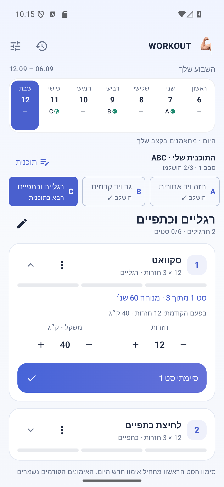
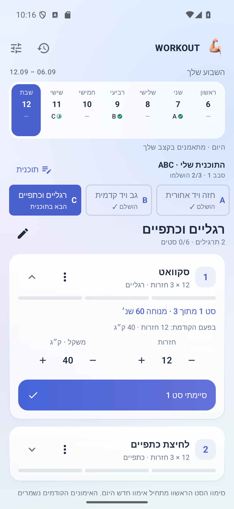

# Workout 3.3.0 — מסירה ובדיקות

12 בספטמבר 2026. `versionCode = 4`, חבילת Android: `com.hananel.workout.rebuilt`.

## קבצים למסירה

- APK: `C:\CodingProjects\Workout-Rebuilt\dist\Workout-3.3.0.apk`
- העתק זהה בשולחן העבודה: `C:\Users\hanan\OneDrive\שולחן העבודה\Workout-3.3.0.apk`
- ארכיון מקור, בדיקות, תיעוד וצילומים: `dist/Workout-3.3-source.zip`
- [סקירת המוצר, כללי האימון וטבלת הכיסוי מול המקור](REVIEW-3.3-HE.md)

SHA-256 של ה־APK בשני המיקומים:

```text
7798B3A457278ED50943FB0D0E57F47B6D05EE8898B3E18D2FBA6C2D84AB5640
```

זהו Release ממוזער וחתום במפתח המקומי הקיים, עם אותה תעודה כמו 3.2. בדיקות `apksigner verify` ו־`zipalign` עברו. SHA-256 של תעודת החתימה:

```text
0bc72414ea223f18d63ea1ebcdc2972f99ba2dc02f826a061478caeb4abb98f2
```

לא שונו הפרויקט המקורי, סידור Git או הבניות הקודמות. בדיקת 75 קובצי מקור מול תמונת המצב מתחילת הסקירה מצאה אפס שינויים. האייקון נשמר. לא בוצעו commit, merge או פרסום.

## התוצאה העיקרית

האימון נשאר פתוח עד סיום ידני כברירת מחדל, גם בשדרוג מנתוני 3.2. נוספו תיקון חזרות/זמן ומשקל לסט האחרון מהכרטיס ומהטיימר, ביטול אימון ריק לאחר ביטול כל הסטים, ושמירת בסיס הסבב בזמן אימון. תוקנו פעולות התראה שהתיישנו, סיום מנוחה ורענון התראות. הובהרו ההיכרות, ניהול התוכנית וסימוני היומן.

ניסוי העיצוב זמין בהגדרות ← מראה ושפה ← גימור הכרטיסים ← זכוכית עדינה. הוא משתמש במשטחים מדורגים, שקיפות מתונה, גבולות וצללים סטטיים ב־Compose. אין טשטוש רקע חי. ״נקי״ נשאר ברירת המחדל. אלו אפשרויות עיצוב של אותה אפליקציה.

## בדיקות אוטומטיות

| בדיקה | תוצאה | ראיה |
|---|---|---|
| JVM — מנוע, תכנון, תיאום ורגרסיות | 67 עברו, ללא כישלונות או דילוגים | `evidence/3.3/TEST-*.xml` |
| שילוב Android | 19 תרחישים עברו | `evidence/3.3/TEST-WorkoutIntegrationTest.xml` |
| מסלול ממשק וצילום | תרחיש נוסף עבר | `evidence/review-3.3-visual-final.log` |
| בניית Release ו־lint | הבנייה עברה; 0 שגיאות lint ו־18 אזהרות | `evidence/release-3.3-validation.log`, `evidence/3.3/lint-results-debug.txt` |

בדיקות JVM: TrainingEngine — 42, Planning — 8, Coordinator — 6, ReviewRegression — 11.

פקודת האימות הסופית:

```powershell
$env:JAVA_HOME = 'C:\Program Files\Android\Android Studio\jbr'
.\gradlew.bat testDebugUnitTest connectedDebugAndroidTest '-Pandroid.testInstrumentationRunnerArguments.class=com.hananel.workout.WorkoutIntegrationTest' assembleRelease lintDebug
```

מסלול הממשק הורץ בנפרד עם המחלקה `com.hananel.workout.ReviewVisualTest`. הוא כולל עברית ואנגלית, פתיחה ותוכנית התחלה, ניהול התוכנית, רישום סט ומנוחה, דיאלוג תיקון, השלמת תרגיל והגעה לפעולות בגלילה עם גופן 160%.

הבדיקות כוללות שמירה ושחזור מצב, פעולות כפולות והתראות ישנות, הארכת מנוחה, חזרה למסך אחרי התראת סיום, סבבים בין שבועות ושינוי תוכנית, תיקון ערך ומשקל, וסירוב הרשאה. הפירוט המדויק מופיע בשמות הבדיקות ובקוד.

## בדיקות ב־APK הסופי

נבדק באמולטור Android 16 / API 36, בתצורת טלפון 1080×2340, צפיפות 420. אין כאן תוצאת בדיקה ממכשיר פיזי.

1. הותקנה גרסת Release 3.2 הקודמת, נוצרה תוכנית ABC ונרשם סט. 3.2 סגרה אותו אוטומטית כרשומה חלקית לפני השדרוג. התקנת 3.3 באמצעות `adb install -r` הצליחה ושמרה את התוכנית והרשומה החלקית. בדיקה זו אינה ראיה לשימור טיימר פעיל מ־3.2, משום שהוא כבר נסגר קודם.
2. ב־3.3 הסופית נרשם סט חדש והמנוחה הושהתה על 00:39. התקנה חוזרת של אותו APK שמרה את הסט ואת אותה מנוחה מושהית. צולמו המצב לפני ואחרי ונשמר ייצוא JSON. ברירת המחדל של סגירה אוטומטית נבדקה ככבויה.
3. ייצוא דרך בורר הקבצים של Android יצר JSON תקין עם האימון הפעיל והמנוחה. לאחר מכן שוחזר הגיבוי שנשמר באמולטור לפני הסקירה. השחזור והייצוא החוזר שמרו את שלושת האימונים, שלוש רשומות ההיסטוריה, מזהי כל הסטים והתקדמות הסבב. נתוני האימונים זהים לגיבוי; `autoCloseIdle=false` נוסף כברירת מחדל. האמולטור נשאר עם הנתונים המשוחזרים ובמראה בהיר עם זכוכית עדינה.
4. נבדקו ידנית בחירת Clean / Soft glass, וכן זכוכית במראה כהה. זוג צילומי הבית נלכד מחדש ב־Release לאחר בחירה ממשית בהגדרות, משום שהלכידה האוטומטית הראשונית תפסה פעמיים את אותו פריים. זוג הצילומים למסירה מציג אותם נתוני אימון ובו שינוי חזותי מאומת.

ראיות: `evidence/release-3.3-install.txt`, `upgrade-before-version.txt`, `upgrade-after-version.txt`, `release-3.3-active-reinstall.txt`, `release-active-after-ui.xml`, `release-3.3-export.json`, `release-settings-manual.xml`, `release-3.3-restored.json`, `release-3.3-restore-check.json`, `release-glass-selected.xml`.

קובצי בדיקת שגיאות וקריסות של ריצת ה־Release ריקים: `evidence/release-3.3-crashes.txt`, `evidence/release-3.3-errors.txt`. זהו תיעוד הריצה שנבדקה, ולא הבטחה שאין באגים.

## צילומי Android אמיתיים

הצילומים משתמשים בנתוני הדגמה באמולטור. נתוני ההדגמה אינם חלק מה־APK להתקנה.

| נקי — Release | זכוכית עדינה — Release |
|---|---|
|  |  |

צילומים נוספים בתיקיית `screenshots/Workout-3.3`: תוכנית, טיימר, תיקון סט, השלמת תרגיל, אנגלית, גופן גדול, פתיחה, תבנית ABC, בדיקות השדרוג ומראה זכוכית כהה. יתר צילומי המסלול נלקחו מבניית Debug עם אותו קוד מוצר.

## מה עדיין לא אומת

לא נבדקו טלפון פיזי, הגבלות סוללה של יצרנים, צליל/רטט בפועל, אתחול פיזי או מכשירי API 26–35. לא נערכה מדידת עומס של אלפי אימונים או מדידת צריכת סוללה/פריימים ממושכת של העיצוב. 18 אזהרות lint נשארו ומתועדות בדוח.

האפליקציה נשארת עצמאית ואופליין. גיבויי האפליקציה המקורית v2 אינם מיובאים אוטומטית. ארכיון המקור אינו מכיל מפתח חתימה, קובצי build או הגדרת SDK מקומית; בנייה במחשב אחר דורשת SDK, JDK והגדרת נתיב, ועדכון התקנה קיימת דורש את אותו מפתח חתימה.
