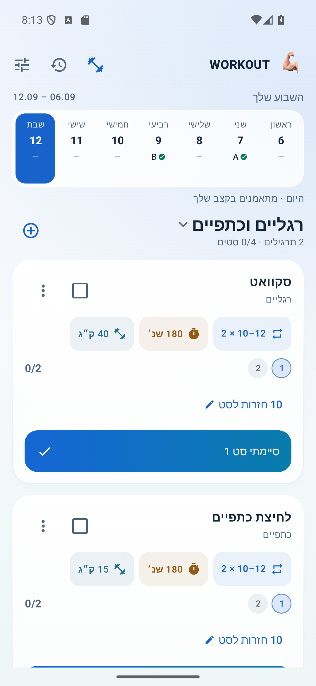
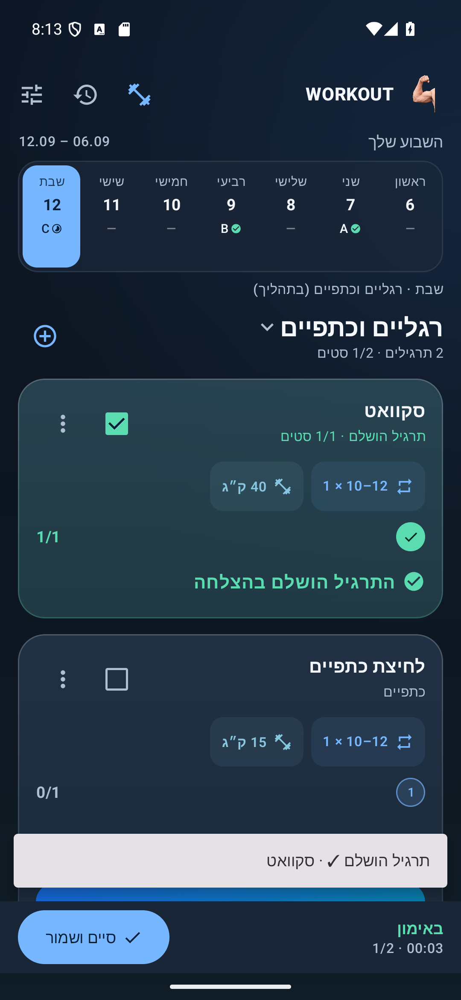

# Workout 3.4.0 — מסירה ובדיקות

13 בספטמבר 2026. `versionCode = 5`, חבילת Android: `com.hananel.workout.rebuilt`.

## קבצים

- APK: `C:\CodingProjects\Workout-Rebuilt\dist\Workout-3.4.0.apk`
- העתק זהה בשולחן העבודה: `C:\Users\hanan\OneDrive\שולחן העבודה\Workout-3.4.0.apk`
- מקור, בדיקות, תיעוד וצילומים: `dist/Workout-3.4-source.zip`
- [הצ׳קליסט המלא והחלטות המוצר לפי המשוב](REFINEMENT-3.4-HE.md)

SHA-256 של ה־APK:

```text
E69AFB09C0E4032828516756A388B07D0BD0527C91BF248C2492681A57F14CEF
```

Release ממוזער, חתום במפתח המקומי הקיים ומתאים לעדכון 3.3. `apksigner verify` ו־`zipalign -c -P 16 -v 4` עברו. SHA-256 של תעודת החתימה:

```text
0bc72414ea223f18d63ea1ebcdc2972f99ba2dc02f826a061478caeb4abb98f2
```

הפרויקט המקורי לא נערך. 75 קובצי המקור שנבדקו מול תמונת המצב מתחילת הסקירה נמצאו זהים. הבניות והארכיונים הקודמים נשמרו. לא בוצעו שינויי Git, commit, merge או פרסום.

## מה השתנה

ניהול התוכנית עבר לכפתור לצד ההיסטוריה ולמסך משלו. במסך האימון נשארו השבוע, בחירת האימון וכרטיסי התרגילים. המשקל גלוי ונשמר גם לפני הסט הראשון; עריכה, תיקון סט, ביטול והשלמה נגישים מהכרטיס. אפשר להוסיף מהמאגר בן 41 התרגילים או ליצור תרגיל אישי גם באימון פעיל. היסטוריית הביצועים נשמרת בנפרד מעריכת היעדים להמשך.

זכוכית עדינה היא הגימור היחיד, בבהיר/כהה/מערכת. היא ממומשת בשקיפות, גבולות, מדרגות צבע וצללים סטטיים של Compose, ללא טשטוש רקע או שבירת אור בזמן אמת. נשמרו האייקון המקורי והטיימר, ונוספו משקל בולט, מעקב סטים, סימון השלמה והודעת הצלחה.

פתיחה ראשונה מציגה בקשת התראות יזומה ב־Android 13 ומעלה. ההיכרות מפרידה בין רצף אימונים לימים קבועים, ומציעה תוכנית לפי קבוצות שריר, ABC או תוכנית אישית.

״סיים ושמור״ נשאר בתחתית בזמן אימון. בקשת המשתמש האחרונה מחליפה את ברירת המחדל של 3.3: סיום אוטומטי אחרי 20 דקות ללא פעולת אימון, גם כאשר המנוחה מושהית. מנוחה שרצה מקבלת את משך הזמן שהוגדר ואז 20 דקות נוספות. צפייה פסיבית לא מאפסת את הזמן; אין חיישן תנועה. בסגירה אוטומטית משך האימון מסתיים בשעת הפעולה האחרונה, כך שהמתנה של שעות לא מנפחת את ההיסטוריה. ניתן לבחור סיום ידני בלבד בהגדרות.

## אימות

| תחום | תוצאה | ראיה |
|---|---|---|
| JVM: מנוע, תכנון, תיאום ורגרסיות | 78 עברו; 0 כישלונות/דילוגים | `evidence/3.4/TEST-com.hananel.workout.*.xml` |
| שילוב Android | 21 תרחישים ייחודיים עברו על פני ריצה מלאה וריצה ממוקדת | `TEST-WorkoutIntegrationTest-first.xml`, `TEST-WorkoutIntegrationTest-focused.xml` |
| מסלולי ממשק וצילום | 4 עברו | `TEST-ReviewVisualTest.xml`, `release-validation.log` |
| בנייה סופית ו־lint | Release עבר; 0 שגיאות ו־18 אזהרות lint | `final-migration-validation.log`, `lint-results-debug.txt` |
| חתימה, יישור וזהות העתקי APK | עברו | `release-signature.txt`, `release-alignment.txt`, `delivery-hashes.txt` |
| שלמות המקור | 75 קבצים; 0 שינויים | `original-integrity.json` |

נתיבי הראיות בטבלה הם ביחס ל־`docs/evidence/3.4`, אלא אם צוין אחרת. פירוט JVM: TrainingEngine — 42, Planning — 8, Coordinator — 6, ReviewRegression — 11, RefinementRegression — 11.

בריצת השילוב המלאה עברו 19 מתוך 21. שתי בדיקות נכשלו: בדיקת היומן הניחה שיום ראשון נשאר ללא אימון גם כשמבוצע בו סט; בדיקת שמירת תרגיל הסתיימה ב־timeout בהמתנה לנתונים. בדיקת היומן הותאמה לתוכן המשתנה, ונוספו בדיקת נראות/זמינות ולכידת חלון לפני שמירה. שתי הבדיקות עברו בריצה ממוקדת; דוחות הכישלונות המקוריים נשמרו. בדיקת מעבר מטיימר לסט הותאמה להמתנה לשמירת סיום המנוחה ועברה בריצה המלאה.

המסלולים כוללים משקל לפני אימון ואחרי טעינה מחדש, עריכת תרגיל פעיל בלי לשכתב סטים קיימים, הוספה מהמאגר ותרגיל אישי, תיקון וביטול, אישור השלמה, עברית/אנגלית, גופן 160%, בהיר/כהה, ימים קבועים מול רצף, רקע ופעולות התראה. נבדקו גם סגירת מנוחה מושהית, התראה ישנה ושימוש במשקל עבודה מעודכן בפעולת ״סט הבא״ מההתראה.

השינוי האחרון אחרי מסלולי Android היה תיקון העברת משקל של תרגיל פעיל מנתוני 3.3. הוא אומת באמצעות בדיקת JVM נוספת, בנייה מחדש ובדיקה ב־APK הסופי עם נתונים שנוצרו ב־3.3. לא נטען שכל מסלולי Android הורצו שוב אחרי שינוי מיגרציה זה.

## בדיקות Release באמולטור

Android 16 / API 36, תצורת טלפון 1080×2340 וצפיפות 420. אלה בדיקות אמולטור, ללא מכשיר פיזי.

1. התקנה נקייה של 3.4 הציגה את ההסבר מיד בפתיחה. ״אפשר התראות״ פתח את חלון הרשאת Android עצמו. בחירת Don’t allow השאירה את תהליך ההיכרות זמין. ראיות: `release-first-open-ready.xml`, `release-permission-denied.xml`, צילום `release-android-permission.png`.
2. הותקנה 3.3 הסופית. נוצרה תוכנית ABC, נרשם סט של 10 חזרות ב־27.5 ק״ג והמנוחה הושהתה ב־00:31. עדכון ל־3.4 עם `adb install -r` שמר את התוכנית, הסט והמנוחה המושהית באותו זמן. ברירות המחדל החדשות glass/autoCloseIdle אומתו בייצוא. ראיות: `upgrade-before-version.txt`, `upgrade-after-version.txt`, `upgrade-install.txt`, `release-upgraded-export.json`, וצילומי `upgrade-3.3-active.png` / `upgrade-3.4-active.png`.
3. בבדיקה זו נמצא שהמשקל נשמר נכון בסט ובתוכנית, אך צילום המצב הפעיל של 3.3 עדיין הכיל משקל ישן. תוקנה המיגרציה כך שהכרטיס הפעיל מקבל את המשקל הזכור בלי לשנות סטים, היסטוריה או טיימר. בדיקת JVM מאמתת גם שמירה על העדפות מאוחרות ואי־חזרה על המיגרציה.
4. ה־APK הסופי הותקן בהצלחה. לבדיקה חוזרת נוצר `legacy-active-fixture.json` מהייצוא של סעיף 2, בשינוי מטא־נתוני ההעדפות בלבד לערכי 3.3 (`appearanceVersion=1`, זכוכית וסגירה אוטומטית כבויות). ייבואו ב־APK הסופי הציג 27.5 ק״ג בכרטיס הפעיל וסט אחד שמור. שחזור גיבוי מבטל מנוחה לפי ההתנהגות הקיימת, לכן בדיקה זו אינה בדיקה נוספת של שימור טיימר בהתקנה. ראיה: `final-migrated-weight.xml`, צילום `release-migrated-weight.png`.
5. בסיום שוחזר באמולטור הגיבוי שנשמר לפני הסקירה, והופק ייצוא חוזר. שלושת האימונים, שלוש רשומות ההיסטוריה והתקדמות הסבב זהים לנתונים שנשמרו; ברירות המחדל עודכנו לזכוכית ולסיום אחרי חוסר פעילות. אין אימון בדיקה פעיל. ראיות: `final-restored-export.json`, `final-restored-check.json`, צילום `release-restored-home.png`.

## צילומים

צילומי ממשק אמיתיים מתוך Android, עם נתוני בדיקה שאינם כלולים ב־APK להתקנה:

| בהיר | כהה והשלמת תרגיל |
|---|---|
|  |  |

בתיקיית `screenshots/Workout-3.4` נמצאים גם תפריט תרגיל, עריכה, שינוי משקל, מאגר, השלמה, סיום אימון, מסך תוכנית, בחירת שיטה, פתיחה ראשונה, אנגלית וגופן גדול. `original-card.png` הוא תיעוד ההשוואה לאפליקציה המקורית.

## גבולות האימות

לא נבדקו מכשיר פיזי, API 26–35, הגבלות סוללה של יצרנים או צליל/רטט בפועל. לא נערכה מדידת ביצועים, צריכת סוללה או עומס ממושכת. 18 אזהרות lint מתועדות בדוח. בלי הרשאת שעונים מדויקים Android עשוי למסור שעון רקע באיחור; ההיסטוריה עדיין נסגרת בשעת הפעולה האחרונה והאפליקציה בודקת שוב בחזרה למסך.

האפליקציה עצמאית ואופליין. נתוני האפליקציה המקורית אינם מיובאים אוטומטית. ארכיון המקור אינו כולל מפתח חתימה, קובצי build או `local.properties`; בנייה במחשב אחר דורשת SDK/JDK, ועדכון התקנה קיימת דורש את אותו מפתח חתימה.
